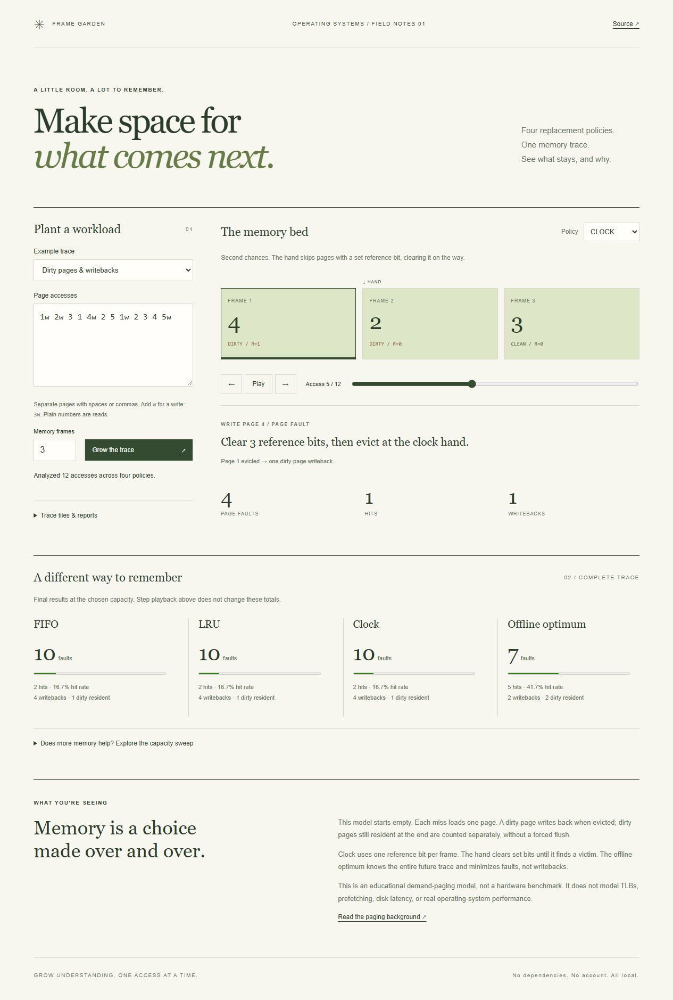

# Frame Garden

A dependency-free operating-systems workbench for exploring how page replacement changes a workload. Compare FIFO, LRU, Clock, and an offline optimum; inspect each access, dirty eviction, and reference bit; then sweep memory capacity to find surprising fault increases.



## Start

```sh
python run.py --port 8000
```

Open http://127.0.0.1:8000. Python 3.10+ is sufficient to run the local server. There are no runtime packages, API keys, external fonts, or network services. Refreshing the browser resets the experiment; use the trace or JSON export to keep it.

## Experiments

- **More memory, more faults:** the default trace gives FIFO 9 page faults at three frames but 10 at four. Expand the capacity sweep to see the increase marked with an arrow.
- **A small working set:** repeatedly return to two pages while introducing new ones; compare FIFO's load order with LRU's access order.
- **Dirty pages & writebacks:** writes mark pages dirty, subsequent reads preserve that flag, and eviction writes back once. Pages still dirty at the end are reported separately.
- **Inspect the mechanism:** choose Clock, step through accesses, and watch the hand and reference bits. Playback is user-controlled and pauses when the tab is hidden.

The frame display and counters describe the current playback position. The four comparison cards and capacity table always describe the complete trace. Editing a trace or capacity clears the old analysis until you submit it again.

## Trace format

```text
1w 2 3r 1 4w 2 5
```

Use page identifiers from `0` to `9999`, separated by whitespace or commas. A trailing `w` denotes a write, `r` a read, and a plain number also denotes a read. Letters are case-insensitive. Leading zeroes, negative values, fractional pages, headers, and other punctuation are rejected.

Plain-text imports use this same format. A CSV trace means comma-separated page tokens without a header, not arbitrary tabular data. Trace exports can be imported again; the analysis JSON is a separate, detailed report containing every policy's states and the capacity sweep.

## Exact model

All policies start with empty frames. Every miss loads the referenced page (demand paging). Reads and writes both count as accesses. There is no prefetching, bypass, background cleaning, or final flush.

| Policy | Victim selection |
| --- | --- |
| FIFO | Resident page loaded earliest; hits do not refresh arrival order. |
| LRU | Resident page whose most recent access is oldest. |
| Clock | Starting at the hand, clear set reference bits until reaching an unset bit. Evict there, load the new page with its reference bit set, and advance the hand. |
| Offline optimum | Resident page whose next access is farthest in the future; never referenced again counts as infinity. Ties choose the lowest frame index. |

Clock fills empty frames in index order and advances the hand after each load. A hit sets its page's reference bit and leaves the hand unchanged. This is a single-bit second-chance policy, not an enhanced Clock policy that prefers clean pages.

A dirty eviction adds one writeback. A newly loaded read page is clean; a newly loaded write page is dirty. The optimum minimizes faults, not writebacks or latency. No results represent measured operating-system performance: the model does not include TLB behavior, asynchronous I/O, page sizes, disk timing, or CPU caches.

## Implementation

- `core.js`: parser, four pure policy simulations, capacity sweeps, and analysis reports.
- `app.js`: playback, input invalidation, file validation, rendering, and downloads.
- `run.py`: loopback-only development server with an asset allowlist, Host validation, and a restrictive content security policy. Not a production server.
- `tests/core.test.js`: independent algorithm checks and workload invariants.

Bounds are 1,000 accesses, 12,000 input characters, 16 frames, and 48 KB per imported file with strict UTF-8 decoding. The capacity sweep covers 1–12 frames, extending to the chosen capacity when it is larger. OPT precomputes future-position lists instead of repeatedly searching the remaining trace. Simulation is O(accesses × frames); captured state is O(accesses × frames). The sweep disables snapshot capture.

## Verify

Node.js 22+ and Python 3.10+:

```sh
node --test
npm run check
python -m unittest discover -s tests -v
```

Ten JavaScript tests include an independent exhaustive victim-selection oracle across all 729 six-access traces over three pages, each at capacities 1–3. Generated workloads check LRU/OPT capacity monotonicity, unique resident pages, and OPT's fault lower bound. Other checks cover FIFO's anomaly, Clock's hand and reference bits, dirty-page accounting, parser rejection, and snapshot independence. A Python test verifies static serving boundaries. CI runs Linux with Node 22/24 and Windows with Node 24.

Browser checks cover policy switching at the end of a trace, capacity-sweep anomaly labels, dirty-page counters, invalid input, clearing stale results, JSON export, and trace-file round trips.

## Background

[University of Wisconsin CS 537 memory-management notes](https://pages.cs.wisc.edu/~solomon/cs537-old/last/paging.html) explain demand paging and replacement policies. The app's explicit conventions above define the simulator's behavior where implementations can differ.
